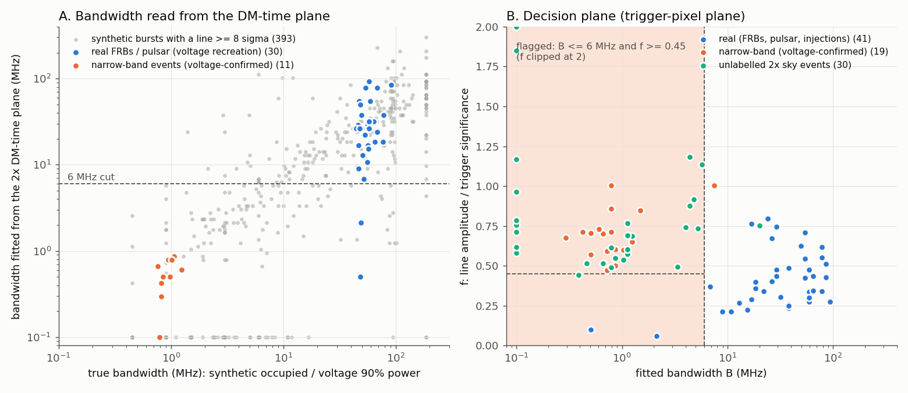

# DM-time ridge: a narrow-band test for C3 (R12) — P0 study, 2026-11-12

**Question.** Can C3 tell, from the 2x DM-time plane alone (no voltages), that a
candidate's emission sits in a few MHz, so it can reject it? The user reads this
by eye ("stripes very extended in DM/time must be narrow-band"); 261111lmnm
(four parallel stripes, voltage spike at 1337 MHz) is the example.

**Answer.** Yes, with a physics fit rather than an image classifier. On every
real event available (26 legacy DSA-110 FRBs, 3 dsart FRBs, B1933+16,
11 injections) the proposed rule flags **none**; it flags 10/11 voltage-confirmed
narrow-band events from their recreated planes, 8/9 from their real cutouts, and
36 of the 40 non-injection sky events since the 2026-11-11 arm (10 of them C3 KEEPs).
The DM-time plane even gives the interferer's frequency to ~1 MHz.

## Physics

The 2x search's time axis is referenced to the bottom of the band (stage 2 reads
`stream[t - a2 * DM]`, `a2` = delay from each sub-band down to `nu_bot`
1311.28 MHz). A signal component at frequency `nu`, seen at a trial DM off by
`dDM` from its own, moves by

    dt = s(nu) * dDM,    s(nu) = k (nu_lo^-2 - nu^-2),   0 <= s <= 0.566 ms per pc/cc

so it draws a straight line through the trigger whose slope **is** its frequency
(lmnm 0.095 → 1338 MHz, dapz 0.105 → 1341 MHz: both their voltage spikes). A
component of bandwidth `B` stays in focus while its own sweep `2 k dDM B / nu^3`
is shorter than the width `w`:

    dDM_c = w nu^3 / (2 k B)     (w = 1 ms: 6 MHz → 58 pc/cc, 20 MHz → 17, full band → 2)

Beyond `dDM_c` it fades as `dDM_c / dDM`. A broadband burst is compact at its
DM and away from it smears into a faint fan over every physical slope.

**Trap (why "extended stripe" alone is not enough).** The real FRB 261110zzeg
also draws a long faint line (bright scintles act like narrow-band components),
and a 17 ms burst 20 MHz wide stays in focus for ±280 pc/cc. The discriminators
are where the line *stops* (→ `B`) and how bright it is relative to the
trigger (→ `f`): a dispersed burst always peaks at its own DM, a narrow-band
impulse is equally bright all along its line and the trigger DM is arbitrary.

## Method — `src/dsart/coinc/dmt_ridge.py`

1. The plane: every half's cutout stacked by DM (`dm_time_from_cutouts`, the
   light curve at the trigger pixel, `pix_lc`), boxcar at the trigger width,
   robust z per DM row (as the dm_time plot).
2. Core: max within ±(w+2) samples and ±1 row of the trigger; lines anchor there.
3. Slope scan: for each frequency (0.5 MHz grid) the median, over rows
   30–600 pc/cc away (further for wide widths), of the max within ±1 sample of
   the line; unphysical slopes (negative / beyond `nu_hi`) give the noise.
4. Profile fit along the best line, over every row:
   `z(dDM) = A min(1, dDM_c(B)/|dDM|)`, `A` least squares per `B` on a log grid
   0.1–300 MHz → `bw_fit_mhz` (+ the Δχ² = 4 range), `f_fit = A / core`,
   `fit_sigma`.

## Truth data

| set | source | n |
|---|---|---|
| legacy FRBs | keep-list `Level3/<ev>_dev_polcal_I.fil` (beamformed at the FRB, dedispersed, 32.8 µs), re-dispersed and run through the plan's own stage-1/stage-2 tables (`tools/x2/dmt_truth.py`) | 26 |
| dsart events with a C3 filterbank | same recreation; label from the voltage spectrum (≥ 50% of on-pulse S/N² in the best 1 MHz = narrow-band) | 19 |
| 2x cutouts | features from the real cutouts: injections, zzeg, B1933+16 (uekr), voltage-labelled narrow-band, unlabelled sky | 52 events |
| synthetic | known spectra (flat, Gaussian 1–120 MHz, scintillated 0.5–5 MHz, narrow-band trains) × width 0.5–17 ms × S/N 10–150 × DM 150–2500 in white noise, recreated the same way (`tools/x2/dmt_synth.py`) | 400 |

The recreation was checked against the real cutouts (lmnm: ridge at 1337.3 vs
1336.8 MHz; windowed == full emulation; unit tests in `tests/test_dmt_ridge.py`,
`tests/x2/test_dmt_truth.py`).

## Results — rule `bw_fit_mhz <= 6 and f_fit >= 0.45 and fit_sigma >= 8` (pix plane)

| class | flagged |
|---|---|
| legacy FRBs (voltage recreation) | **0 / 26** |
| dsart FRBs twmx, quga, zzeg (voltages) + zzeg (cutout) | **0 / 4** |
| B1933+16 (voltages + cutout) | **0 / 2** |
| injections (cutouts) | **0 / 11** |
| narrow-band, voltage-confirmed: recreated / real cutouts | **10 / 11**, **8 / 9** |
| unlabelled 2x sky since 11-11 (cutouts) | 28 / 31 |
| synthetic, true occupied bandwidth 0-3 / 3-6 / 6-10 / 10-20 / 20-40 / >40 MHz | 0.81 / 0.73 / 0.50 / 0.19 / 0.03 / 0.00 |

C3 KEEPs since 11-11 that R12 would reject: anyh, ayxd, dapz, dnpw, esom, lmnm,
lusl, xtla, teua, zjpu (lines at 1316–1372 MHz; 7 voltage-confirmed). The
16.8 ms "wide" flood (uqem, vcaj, puwj, rcbf, vrei, lebw, qtya, tcmc, gtxm, …)
is narrow-band lines at 1318–1349 MHz.

## Limits and residual risk

* **Wide bursts resolve bandwidth worse.** `dDM_c` scales with `w`, and the DM
  range is finite, so at 8–17 ms the effective cut is ~10–15 MHz: 3 synthetic
  band-limited bursts (7–11 MHz FWHM) at w 16–32 were flagged; qgls (voltage
  0.85 MHz, triggered at 16.8 ms on a pulse train) was missed at B 7.5.
* **Closest real event:** legacy FRB 230628aaaa (voltage 90% bandwidth 52 MHz,
  emission piled at the bottom band edge) fits B 6.9 MHz, f 0.37 — outside on
  both conditions, but by ~15% on each. Faint FRBs 231123aacm and 240203aacl
  fit B 0.5 / 2.1 MHz on noise/scintle lines and are excluded only by f 0.10 / 0.06.
* One synthetic band-limited burst (14 MHz FWHM, S/N 10, DM 2500) was flagged.
* The image-max plane (what the plot shows) separates less well (narrow-band
  6/9); the rule uses the trigger-pixel plane.
* Injections are flat-spectrum: they test the null side, not band-limited FRBs.
  Spectral-shape injections (per-channel weights in the corr injector) would
  test the rule end to end on sky.

## Proposed next steps

* **P1 (shadow, C3):** compute these features in C3 for every event; write them
  and R12's would-be verdict to `C3_decision.json`; never act. Archive the
  stacked DM-time plane + features (~0.8 MB/event) for every event, including
  rejects, outside the event dir. Watch: R12 must never fire on an injection or
  a B1933+16 pulse; check its verdicts against every new voltage spectrum.
* **P2:** the 64-sub-band spectrum at the trigger pixel from the raw windows
  (2.93 MHz) — width-independent, removes the wide-burst resolution limit.
* **P3 (user-approved action):** R12 = REJECT (no voltages, no cubes kept),
  once P1/P2 agree.

## Reproduce

    # truth set (h23 CPU; ~1 min per filterbank)
    python tools/x2/dmt_truth.py --plan /home/ubuntu/data/dm_plans/dm_plan_tiered_ns4.npz \
        --out truth.jsonl --planes PLANES/planes_truth --legacy-keep /dataz/dsa110/saveDirs.keep \
        --dsart-glob '/dataz/dsa110/candidates/26*/filterbank/*.fil'
    # synthetic sweep
    python tools/x2/dmt_synth.py --plan ... --out synth.jsonl --n 400 --planes PLANES/planes_synth
    # re-score saved planes + cutouts with the current module, evaluate, figure
    DMT_STUDY_PLANES=/dataz/dsa110/operations/x2/dmt_ridge_study python docs/x2/dmt_ridge_study/rescore.py
    python docs/x2/dmt_ridge_study/final_table.py
    python docs/x2/dmt_ridge_study/ridge_figure.py docs/x2/dmt_ridge_study/figure.png

Data: `data/` (features, labels); planes in
`/dataz/dsa110/operations/x2/dmt_ridge_study/` (145 MB, float16).
